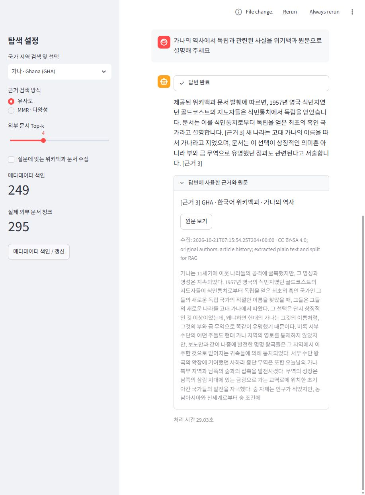

# World Insight AI

SSAFY AI 코어 프로젝트에서 국가·지역 정보를 탐색할 수 있는 RAG 서비스를 만들었습니다. 국가를 선택하고 질문하면 **국가 메타데이터와 한국어 위키백과 원문**을 검색해 **답변과 출처 링크**를 보여줍니다.

## 주요 기능

| 기능 | 사용 예시 |
| --- | --- |
| **국가 채팅** | 가나를 고르고 독립 역사 질문하기. 답변의 `[근거 N]`에 연결된 원문과 발췌 내용을 확인할 수 있습니다. |
| **두 국가 비교** | 한국과 일본의 수도·언어·면적 비교하기. 국가별로 근거를 검색하고 답변에 출처를 표시합니다. |
| **조건으로 찾기** | `유럽에서 독일어를 사용하는 국가` 검색하기. 결과 카드에서 해당 국가의 채팅으로 이동할 수 있습니다. |
| **검색 방식 선택** | 같은 질문에 유사도 검색과 MMR을 적용하고 외부 문서의 Top-k를 조절할 수 있습니다. |



[국가 채팅](docs/screenshots/01_country_chat.jpg) · [조건 탐색](docs/screenshots/03_conditions.jpg) · [결과에서 채팅으로 이동](docs/screenshots/04_card_to_chat.jpg) · [두 국가 비교](docs/screenshots/05_comparison.jpg)

## 실행 방법

검증 환경은 **Windows PowerShell / Python 3.12**입니다. 메타데이터와 수집한 원문은 저장소에 포함되어 있고, Chroma 색인은 로컬에서 생성합니다.

```powershell
git clone https://github.com/yeochang-yoon/world-insight-rag.git
cd world-insight-rag
python -m venv .venv
.\.venv\Scripts\python.exe -m pip install -r requirements.txt
if (!(Test-Path .env)) { Copy-Item .env.example .env }
```

`.env`에 본인의 `OPENAI_API_KEY`를 입력합니다. 기본 설정은 SSAFY GMS입니다. 다른 제공자를 쓰려면 `OPENAI_BASE_URL`, `OPENAI_MODEL`, `EMBEDDING_MODEL`을 계정에서 지원하는 값으로 설정하세요. 같은 API 주소와 키로 Responses API와 임베딩 API를 호출합니다.

```powershell
.\.venv\Scripts\python.exe -m world_insight.cli index-meta
.\.venv\Scripts\python.exe -m world_insight.cli index-docs
.\.venv\Scripts\python.exe -m streamlit run app.py --server.address 127.0.0.1 --server.port 8502 --browser.gatherUsageStats false
```

[로컬 앱](http://127.0.0.1:8502)에서 **가나(GHA)**를 선택합니다. 기본으로 켜진 **질문에 맞는 위키백과 문서 수집**을 해제하고 `가나의 역사에서 독립과 관련된 사실을 위키백과 원문으로 설명해 주세요`라고 질문하면 동봉된 원문으로 기능을 확인할 수 있습니다. 새 문서도 수집하려면 `.env`에 `WIKI_CONTACT`를 설정하고 해당 옵션을 켜세요. [상세 실행 가이드](docs/GETTING_STARTED.md)

## 구현

Python으로 RAG 파이프라인을 구현하고, Streamlit으로 화면을 구성했습니다. LangChain과 ChromaDB로 문서를 색인·검색하고, LangGraph로 검색과 답변 생성을 연결합니다.

1. 선택한 국가의 메타데이터를 ISO3 코드로 조회하고, 해당 국가의 위키백과 문서 청크를 벡터 검색합니다.
2. 검색한 근거를 바탕으로 답변을 생성합니다. 인용 번호와 발췌문을 대조하고 별도 LLM 호출로 답변이 근거에 있는지 확인합니다.
3. 검증을 통과하면 답변과 원문 링크를 표시하고, 근거가 부족하면 확인 불가로 안내합니다.

저장소에는 ISO 국가·지역 메타데이터 249건과 11개 국가·지역의 한국어 위키백과 원문 26건이 포함되어 있습니다. [데이터 출처와 이용 조건](docs/SOURCES_AND_LICENSES.md)

## 폴더 구조

```text
world-insight-rag/
├── app.py             Streamlit UI
├── world_insight/     수집·색인·검색·답변 생성과 CLI
├── data/              국가 메타데이터·위키백과 원문
├── scripts/           데이터 구축·수집·검증 스크립트
├── tests/             RAG 및 UI 자동 테스트
└── docs/
    ├── design/        RAG 파이프라인 설계
    ├── validation/    테스트와 MMR 실험 결과
    ├── evidence/      실험 JSON과 테스트 XML
    └── screenshots/   기능별 실행 화면
```

[파이프라인 상세 설계](docs/design/RAG_ARCHITECTURE.md)
