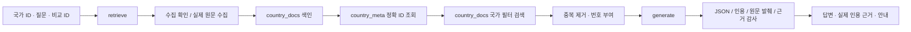

# RAG 파이프라인 설계

## 데이터 경계

이 프로젝트는 국가·지역 메타데이터 249건과 수집한 위키백과 원문을 사용한다. 원본 메타데이터와 시험 노트의 해시는 검증용으로 기록했다. [데이터 기준 해시](../evidence_data_hashes.json)

메타데이터는 pycountry, Babel/CLDR, CountryInfo의 기존 search_text를 재사용한다. CountryInfo의 최신성과 독립국 여부를 보장하지 않는다. 누락은 None/빈 배열로 남기며 화면은 정보 없음으로 해석한다. 시험 노트나 wiki_search_url을 위키백과 원문으로 승격하지 않는다.

## 컬렉션과 ID

| 컬렉션 | 저장 단위 / ID | 주요 메타데이터 |
|---|---|---|
| country_meta | 국가 1건 / ISO3 | item_id, name_ko, title, source_type=metadata, source_name, source_url, region_en, fingerprint |
| country_docs | 실제 원문 청크 / ISO3:wikipedia:pageid:chunk_index | item_id, title, source_type=external_document, source_name, source_url, document_id, collected_at, license_notice, wiki_pageid, chunk_index, fingerprint |

원문 레코드에는 revision_id, history_url, is_country_article도 보관한다. 동일 pageid를 두 국가에 연결해도 ISO3 접두어가 달라 덮어쓰지 않는다. 컬렉션에 임베딩 모델명을 저장하고 모델 변경 시 기존 DB를 조용히 재사용하지 않는다. 두 컬렉션 모두 같은 설정 모델을 사용한다.

## 수집·색인

1. 프롬프트 1로 국가+질문을 JSON 검색어로 변환한다. 국가명은 코드에서도 강제로 포함한다.
2. MediaWiki API로 정확한 국가 제목과 리다이렉트를 해석하고 후보의 제목·pageid·도입 요약을 수집한다.
3. 프롬프트 2가 관련 후보를 고른다. 동음이의어는 제외하고 식별자가 후보 집합 밖이면 거부한다. 국가 자체 문서는 API에서 검증된 경우 우선 강제 포함한다.
4. 선별된 pageid의 본문과 API fullurl을 가져온다. 요청 pageid와 응답 pageid, https/ko.wikipedia.org/wiki/ 경로, 비어 있지 않은 본문을 검증한다. 검색 화면 URL은 거부한다.
5. 원문을 기존 JSONL에 병합한다. 키는 국가+pageid이며 이전 국가 레코드를 삭제하지 않는다. 이미 저장된 문서는 다시 수집·임베딩하지 않는다.
6. RecursiveCharacterTextSplitter로 1000자/200자 중복 청킹한다. 문단·줄·문장·공백 순 경계를 사용한다. 해시가 같은 청크는 건너뛰고 변경분만 Chroma upsert한다. 새 임베딩 성공 후 남는 이전 청크만 정리한다.

User-Agent 실제 연락처, 직렬 API 요청, 요청 간격, maxlag=5, 429/5xx·maxlag/ratelimited 재시도, Retry-After, 요청 상한을 구현했다. API 매개변수별 JSON 캐시와 국가·질문별 선별 상태 캐시가 있다. 외부 호출 실패는 성공으로 캐시하지 않는다. 성공한 빈 결과는 중복 검색 방지를 위해 캐시한다. 캐시 갱신은 명시적 새 수집으로 수행한다.

## 검색과 LangGraph

State는 question, item_id, compare_id, method, k, evidence, answer, citations, notices를 갖는다. 그래프의 명시적 노드는 retrieve와 generate 두 개다. retrieve는 수집 실패 시 안내를 남기고 확보된 문서로 검색한다. 메타데이터가 없으면 색인 안내로 중단한다.

메타데이터는 ISO3 정확 조회로 항상 첫 근거에 둔다. 외부 문서는 item_id 필터로만 검색하고 결과를 다시 국가 ID로 검증한다. 문서 ID+본문 중복을 제거한다. Top-k=4는 외부 청크 최대 수이며 메타데이터 1개가 추가된다. 비교는 국가마다 검색한 후 전체 근거 번호를 다시 부여한다.

기본 유사도 검색은 후보 최대 fetch_k=20개 중 중복 없는 k개를 선택한다. MMR은 같은 필터에서 fetch_k 후보의 관련성과 다양성을 lambda_mult로 조절해 k개를 고른다. 기본 lambda=.5이며 실제 비교 검증에는 .3을 사용했다. MMR이 언제나 더 정확하거나 서로 다른 문서 제목을 반환한다고 가정하지 않는다. 실제 청크 ID 차이와 본문을 함께 비교한다.

## 프롬프트와 검증

검색어 추출, 후보 선별, 답변 생성, 근거 감사에 쓰는 프롬프트는 한 모듈에 있다. [프롬프트 코드](../../world_insight/prompts.py)

| 프롬프트 | 입력 / 출력 | 결정 이유 |
|---|---|---|
| 1 검색어 추출 | 국가·질문 → {queries:[국가명, 주제 검색어]} | 검색과 응답 생성을 분리하고 국가 자체 문서 누락 방지 |
| 2 후보 선별 | 제목·요약·pageid → selected_pageids, deferred_pageids | 본문 다운로드 전 잘못된 문서 제외, 애매한 후보 보류 |
| 3 답변 생성 | 번호가 있는 근거 → answer, claims(근거 번호·원문 발췌) | 문서 밖 지식·추측·허위 인용 금지, 확인 불가 허용 |

예: 대한민국 + '지리적 위치는?' → queries=['대한민국','대한민국 지리']. JSON 파싱 오류, 빈/과대 검색어 목록, 후보 밖 pageid를 거부한다. 답변의 [근거 N]을 실제 목록과 대조하고 사용한 근거만 citations에 남긴다. claims의 발췌는 실제 근거에 있어야 하며 별도 LLM 감사로 주장 전체를 점검한다. 보류 시 '제공된 문서에서 확인할 수 없습니다'로 응답한다. 확률적 모델의 감사가 절대적 사실 보증은 아니므로 원문을 사용자에게 함께 제공한다.

## 조건 탐색·비교·UI

조건은 LLM이 허용된 구조화 필터로 변환하고 실제 속성과 AND 비교한다. 249건 전체 벡터 후보를 가져와 필터로 검증하므로 낮은 순위 일치 국가가 임의 cutoff로 사라지지 않는다. region/language/currency는 정확 비교, 면적은 수치 비교, 이름·수도의 contains는 부분 일치를 지원한다. 누락은 판정 보류, 명시적 불일치는 제외다. 지원 못하는 조건은 전체 후보를 보여주는 대신 안내한다.

국가 비교는 같은 그래프로 두 국가를 검색하여 메타데이터와 확보된 외부 문서의 공통점·차이점을 답한다. 출처와 국가 ID를 함께 표시한다. 국가별 채팅은 session_state.histories[ISO3]로 분리하며 새 브라우저 세션에서 영구 복원을 제공하지는 않는다. 수집/색인/검색/생성 상태, 키 없음·색인 없음·빈 결과·API 실패 안내를 구현했다.

## 알려진 한계

외부 원문은 일부 국가에 한해 사전 수집했다. 질문 시 필요한 문서를 수집하거나 CLI로 범위를 확장한다. CountryInfo 값은 원본을 유지한다. 최신 정보가 필요한 질문에 외부 근거가 없으면 답변을 보류한다. 최초 수집과 생성 이후 감사 호출은 응답 시간을 늘린다. [검증 결과와 측정 조건](../validation/TEST_RESULTS.md)
